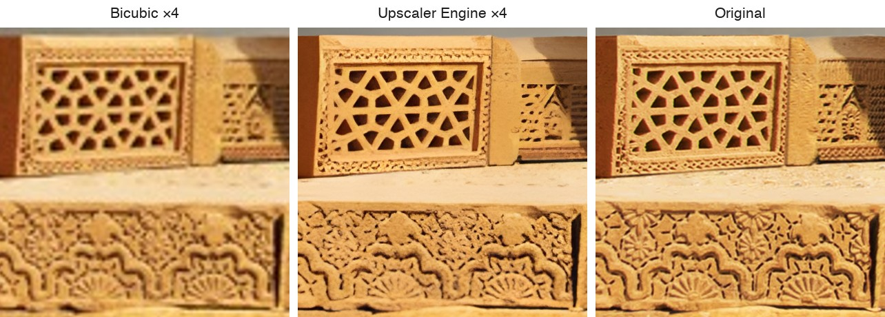
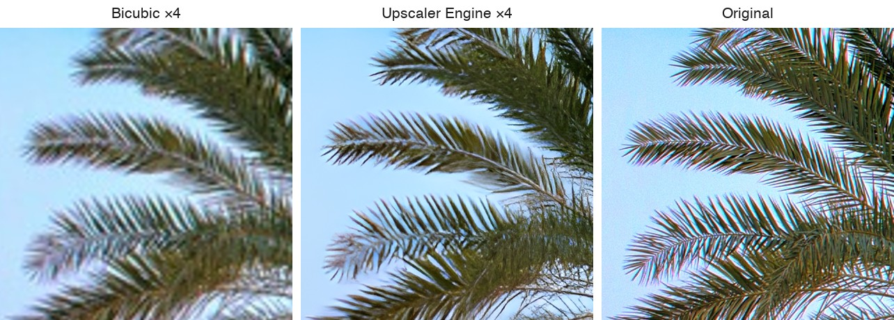

# Upscaler Engine

An on-device image super-resolution engine for Apple platforms. It runs Real-ESRGAN-family models
through Core ML as fixed-shape tiles, stitches them without visible seams, and keeps a 48-megapixel
job inside an iPhone's memory budget — degrading gracefully under pressure instead of being killed.

Swift 6, strict concurrency, no third-party dependencies. A Python toolchain handles PyTorch → Core
ML conversion and measures every claim against a PyTorch reference oracle.



*A quarter-size copy of a photograph, upscaled ×4 with `RealESRGAN_x4plus` and cropped at 100%,
beside bicubic interpolation and the original. More [results](#results) below.*

## What it does

- **Tiling with measured context margins.** Each model's margin is derived from its receptive field
  by a pad-and-probe measurement (16 px for `realesr-general-x4v3`, 76 px for `RealESRGAN_x4plus`),
  never copied from upstream. Four stitch methods are implemented and compared on the same grid;
  centre-valid-region is the default because blending softens detail.
- **Memory that scales with width, not area.** A band-spooled destination keeps only the rows a
  tile row can still write and spools the rest to disk, so a 48 MP → 4× output costs ≈ 200 MiB of
  residency instead of ≈ 3 GiB.
- **A proactive memory budget and an adaptive tile ladder.** Before an image starts, the budget
  decides which tile shape fits `ρ × os_proc_available_memory()`. Under memory pressure or a failed
  tile, the ladder steps 512 → 384 → 256 mid-image and re-grids only the unassembled remainder; at
  the floor it continues degraded rather than failing the job.
- **A colour-correct image pipeline.** Decode preserves Display P3 and ICC profiles, refuses
  unsupported or truncated input before any pixel is decoded, normalises EXIF orientation, carries
  metadata through to the written file, and upscales alpha separately from colour.
- **Honest previews.** A region of an image can be upscaled with context read from the full image,
  bit-identical to the same region of a whole-image run.
- **A job state machine** with phased, monotonic progress and an ETA that states its own evidence.
- **Certification tooling:** reproducible conversion with identity manifests, a PyTorch reference
  oracle, Level A/B metrics, tiling seam certification and context-margin derivation.

## Results

Each comparison takes a photograph, shrinks it to a quarter of its size, and upscales it back ×4.
Crops are shown at 100%.



Thin, high-contrast structure such as fronds against the sky is recovered cleanly — here even
without the colour fringing of the original. The model smooths what it cannot resolve rather than
inventing detail, and very fine, low-contrast ornament can come back flatter than it was; see
[what to expect from the models](docs/MODELS.md#what-to-expect-from-the-models).

Photographs by Yasir Dora: [Chaukhandi tombs, Sindh](https://commons.wikimedia.org/wiki/File:Sindh_monument_at_chaukhandi_pakistan.jpg)
and [date palm, Balochistan](https://commons.wikimedia.org/wiki/File:Date_palm_tree_balochistan_pakistan.jpg),
CC BY-SA 4.0.

## Requirements

- macOS 15 or later with Xcode 16 or later (Swift 6). The engine targets iOS 18 and macOS 15.
- Python 3.12 for the tools under `tools/` (optional; only needed to convert models).
- A physical iPhone or iPad for device measurements (`DeviceHarnessApp`).

## Getting started

Build and test the Swift packages:

```bash
swift build
swift test
```

Convert a model and upscale an image (see [`docs/MODELS.md`](docs/MODELS.md) for the details):

```bash
python3.12 -m venv .venv && source .venv/bin/activate
pip install -r tools/convert/requirements.txt
python tools/artifacts/fetch.py --model RealESRGAN_x4plus
python tools/fixtures/make_fixtures.py
python tools/convert/convert.py --model RealESRGAN_x4plus
swift run UpscaleCLI upscale-image --model RealESRGAN_x4plus \
    --input photo.png --output photo_x4.png --method centerValidRegion
```

## Using the library

Add the package and depend on the products you need (`UpscaleCore`, `ImagePipeline`):

```swift
.package(url: "https://github.com/Yasirdora/upscaler-engine.git", branch: "main")
```

The core of an upscale:

```swift
import ImagePipeline
import UpscaleCore

// Decode into the engine's input contract, keeping the colour profile and metadata.
let decoded = try Decode.decode(contentsOf: inputURL)
let plan = try Color.plan(for: decoded.color)

// Describe and load a converted model. Margins are measured per model, never guessed.
guard let margin = ContextMargin.derivedMargin(for: "RealESRGAN_x4plus") else { return }
let model = ModelDescriptor(
    identifier: "RealESRGAN_x4plus", scaleFactor: 4, contextMargin: margin,
    packageURL: packageURL, inputTileSize: 256, precision: .float16)
let backend = CoreMLBackend()
try await backend.load(model, context: InferenceContext(computeUnits: .all))

// Upscale tile by tile, then write the result with the planned profile and original metadata.
let engine = SequentialTilingEngine(contextMargin: margin)
let upscaled = try await engine.upscale(
    decoded.pixelBuffer, model: model, backend: backend,
    method: .centerValidRegion, progress: nil)
try Encode.write(
    upscaled, to: outputURL, format: .png, plan: plan,
    properties: try Metadata.normalisedProperties(from: decoded.metadata))
```

[`Examples/UpscaleImage`](Examples/UpscaleImage) is the complete, runnable version, including
orientation and alpha handling. The tests under `Tests/` are the reference for everything else:
the memory budget, the tile ladder, the band-spooled destination and the job state machine.

## Repository layout

| Path | Contents |
|---|---|
| `Sources/UpscaleCore/` | Inference backend, tile planner and stitchers, memory budget, pressure response, tile ladder, scheduling |
| `Sources/ImagePipeline/` | Decode, colour policy, alpha, metadata and encode |
| `Sources/ModelStore/` | Model location and verification seams |
| `Sources/Benchmarking/`, `Sources/TestFixtures/` | Measurement namespace; certification corpus, workloads and reference manifest |
| `Sources/UpscaleCLI/` | macOS CLI: `upscale-tile`, `upscale-image`, `derive-context-margin`, `certify-tiling` |
| `Sources/DeviceHarness/`, `DeviceHarnessApp/` | On-device benchmark harness and its minimal iOS app |
| `Tests/` | Swift Testing suites — model-free, device-free, with hand-derived literal expectations |
| `Examples/` | Runnable example packages that use the engine as a dependency |
| `tools/` | Python: conversion, artifact fetch, reference oracle, certification, margin derivation, fixtures |
| `models/` | Per-model identity manifests (weights and packages are fetched and generated, never committed) |
| `docs/` | [Certification spec](docs/CERTIFICATION.md) and [models guide](docs/MODELS.md) |

Module boundaries are dependency edges in `Package.swift`, enforced by an import check in CI:
`UpscaleCore` never imports `ImagePipeline` or `ModelStore`, and no engine module imports a UI
framework.

## Status

Pre-1.0: the engine, image pipeline and tooling are implemented and tested; job orchestration
(`Pipeline`) and the model registry (`ModelStore`) are thin seams that an app fills in. APIs may
change before 1.0.

## Contributing

See [`CONTRIBUTING.md`](CONTRIBUTING.md).

## Licence

The code is released under the [MIT License](LICENSE). Model weights are not included and are
subject to their publishers' terms — see [`THIRD_PARTY_NOTICES.md`](THIRD_PARTY_NOTICES.md).
